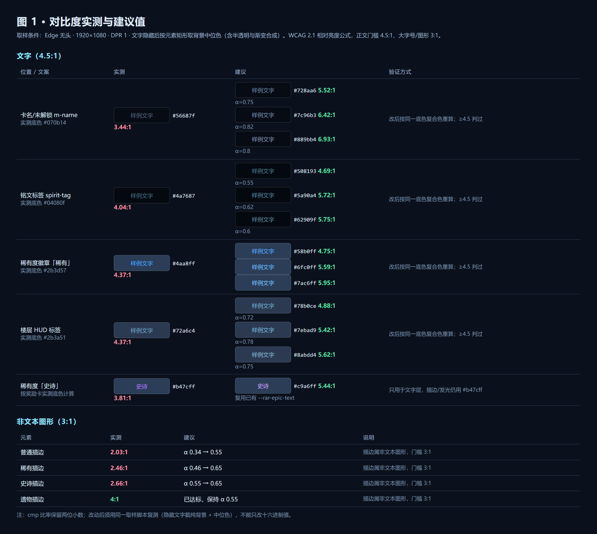
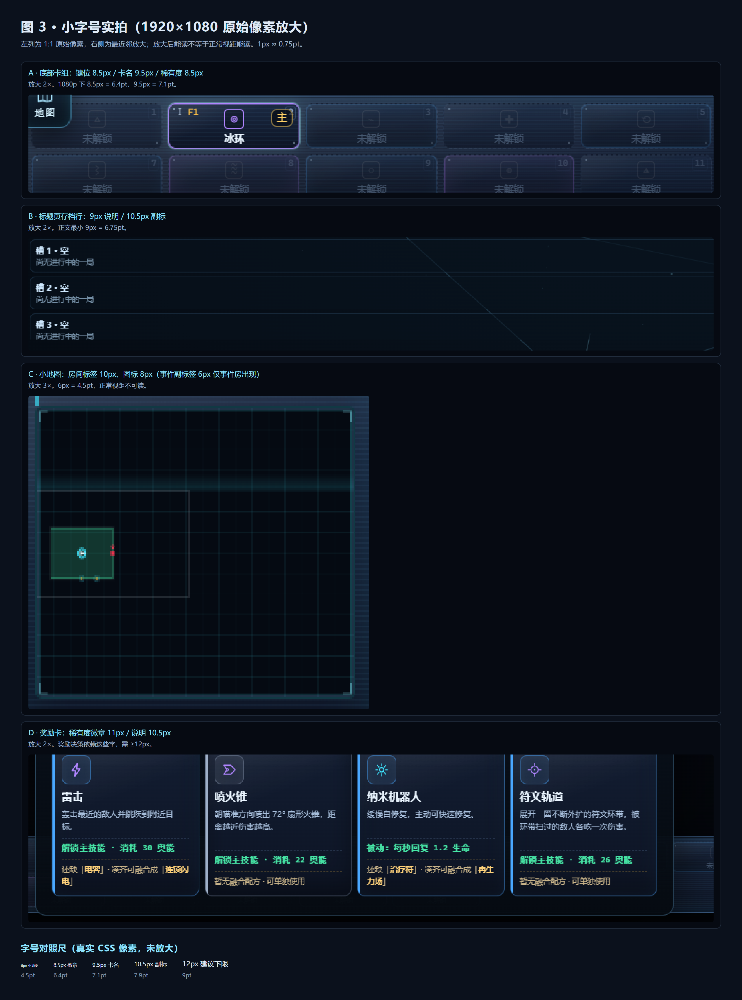
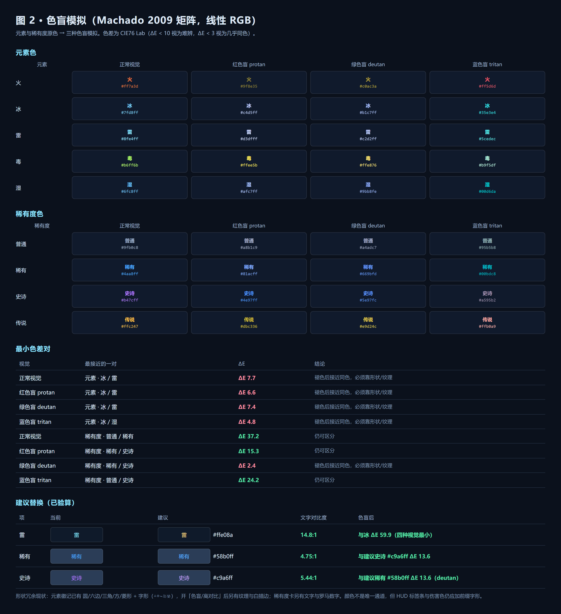

# 《烬》无障碍与可读性审计

> 只读审计：未修改 [index_arcane_v2.html](file:///D:/其他/TRAE宝/奥术工程师/index_arcane_v2.html)。所有“改后值”均为按 WCAG 2.1 公式复算，不是估算。
>
> 环境：Edge 无头（Chromium）· 视口 1920×1080 · DPR 1 · 7 个界面（标题 / 局内 HUD / 设置 / 规则 / 图鉴 / 技能树 / 奖励）。
> 取样：先截正常帧，再在同一布局下把文字设为透明截“纯背景”帧，按文字包围盒取背景中位色（含半透明、渐变与画布合成），前景按 alpha 与背景复合后算亮度比。共测得 **1,523** 个可见文本节点，其中 **392** 个字号 < 11px。

## 结论摘要

| 项 | 结果 | 关键数字 |
|---|---|---|
| 对比度 | **不通过** | 1,370 个可取样节点中 152 个低于门槛（11.1%），集中在 4 个样式；另有史诗稀有度 3.81:1；画布房间名 2.52:1；4 条稀有度描边 2.03–2.66:1 |
| 字号 | **不通过** | 58 处 CSS 声明 < 11px；16 处画布字号 < 11px；最小 6px = 4.5pt |
| 色盲 | **部分通过** | 冰/雷正常视觉 ΔE 7.7（已接近同色）；稀有/史诗绿色盲 ΔE **2.4**；已有形状/纹理兜底 |
| 动效 | **不通过“可关闭”** | 20s 压力战斗：屏震 36 次（1.8/s，峰值 4px）；整屏闪白 37 次（1.85/s，**任意 1 秒最多 4 次**，最小间隔 103.7ms）；顿帧无开关 |
| 按键 | **部分通过** | 瞄准只能靠指针；无改键；手柄无右摇杆瞄准 |
| 读屏 | **不通过** | 画布仅有 `aria-label`，无角色、无状态播报；菜单 DOM 可聚焦 |

---

## 1. 对比度实测



### 1.1 正文失败项（门槛 4.5:1）

| 位置 | 字号 | 实测前景（已复合） | 实测背景 | 实测 | 问题 | 建议值 | 改后（复算） | 验证 |
|---|---|---|---|---|---|---|---|---|
| 锁定卡名 `.mini-card.is-locked .m-name`（[L999](file:///D:/其他/TRAE宝/奥术工程师/index_arcane_v2.html#L999)） | 9.5px | `#56687f`（rgba(150,180,214,.55)） | `#070b14` | **3.44:1** | 卡名是选卡决策信息，却被压到 55% 透明度 | `rgba(150,180,214,.75)` | **5.52:1** | 改后截图取同一矩形中位色重算 |
| 铭文标签 `.spirit-line .spirit-tag`（[L1387](file:///D:/其他/TRAE宝/奥术工程师/index_arcane_v2.html#L1387)） | 10.5px | `#4a7687`（rgba(143,228,255,.5)） | `#04080f` | **4.04:1** | 差 0.46；战斗中最常瞥的一行字 | `rgba(143,228,255,.55)` | **4.69:1** | 同上 |
| 楼层 HUD 竖排标签（[L3967](file:///D:/其他/TRAE宝/奥术工程师/index_arcane_v2.html#L3967)） | 11px | `#72a6c4`（rgba(150,222,255,.66)） | `#2b3a51` | **4.37:1** | 差 0.13；竖排更放大可读性问题 | `rgba(150,222,255,.72)` | **4.88:1** | 同上 |
| 稀有度徽章「稀有」（`--rar-rare`，[L95](file:///D:/其他/TRAE宝/奥术工程师/index_arcane_v2.html#L95)） | 11px | `#4aa8ff` | `#2b3d57` | **4.37:1** | 蓝色在深蓝底上亮度不足 | `#58b0ff`（新增 `--rar-rare-text`） | **4.75:1** | 同底色重算 |
| 稀有度徽章「史诗」（`--rar-epic`，[L96](file:///D:/其他/TRAE宝/奥术工程师/index_arcane_v2.html#L96)） | 11px | `#b47cff` | `#2b3d57` | **3.81:1**（按同款徽章底色计算） | 比稀有更差；现成 `--rar-epic-text:#c9a6ff` 未被使用 | `#c9a6ff` | **5.44:1** | 同上 |

> 其余 148 个失败实例是上述 4 个样式的重复（多张锁定小卡 / 多个界面），没有新增色值问题。标题页角落 9px 小字为 **4.73:1**，刚过线，但字号仍是问题（见第 2 节）。

### 1.2 非文本图形（门槛 3:1）

| 元素 | 实测 | 问题 | 建议 | 改后 |
|---|---|---|---|---|
| 普通卡描边 α0.34 | **2.03:1** | 只靠颜色区分稀有度时，低视力看不见 | α → 0.55 | **3.23:1** |
| 稀有卡描边 α0.46 | **2.46:1** | 与普通卡灰度差也很小 | α → 0.65 | **3.59:1** |
| 史诗卡描边 α0.55 | **2.66:1** | 描边在卡片边缘被底色吃掉 | α → 0.65 | **3.20:1** |
| 传说卡描边 α0.55 | **4.00:1** | 已达标 | 保持 | 4.00:1 |
| 画布房间名（10px，α0.34 强调色） | **2.52:1** | 叠加在深色地面上，10px 直接读不清 | α → 0.65（**6.03:1**） | 采样同帧地色重算 |

补充：画布元素徽记色本身对比充足（火 **9.25:1**、冰 **12.16:1**、雷 **13.58:1**、毒 **16.16:1**、湿 **10.51:1**，底色为徽记底板复合色），问题在字号与色盲区分，不在亮度。

### 1.3 建议补丁（CSS）

```css
/* L999：3.44 → 5.52 */
.mini-card.is-locked .m-name { color: rgba(150, 180, 214, .75); }

/* L1387：4.04 → 4.69 */
.spirit-line .spirit-tag { color: rgba(143, 228, 255, .55); }

/* L3967：4.37 → 4.88 */
body.ui-v2 .floor-head span { color: rgba(150, 222, 255, .72); }

/* L95-96：文字层新增专用色，描边/发光仍用原色 */
:root { --rar-rare-text: #58b0ff; --rar-epic-text: #c9a6ff; }
.reward-card.rarity-rare .r-rarity { color: var(--rar-rare-text); }
.reward-card.rarity-epic .r-rarity { color: var(--rar-epic-text); }
```

验证方式：改后用同一脚本（隐藏文字截纯背景 + 矩形中位色）复测 7 屏，要求 0 个 < 4.5:1；并在 2560×1440 DPR2 再跑一次，确认半透明叠加后仍达标。

---

## 2. 字号与行高



### 2.1 CSS 侧：58 处 < 11px（按可见样式归并）

| 字号 | 位置 / 类名 | 代表文本 | 对比度 | 判定 |
|---|---|---|---|---|
| 8.5px | `.m-key` 键位角标 | `1` | 10.45 | 可辨但太小 |
| 8.5px | `.m-rarity` 稀有度罗马字 | `Ⅰ` | 8.92 | 同上 |
| 8.5px | `.m-floor` 楼层角标 | `F1` | 12.24 | 同上 |
| 9px | `.title-corner` / `.title-ver` / `.titleAuthor` | 版本号、作者 | 4.73 | 刚过对比线，但 9px |
| 9px | `.difficultyNormalText` / `.t-cat` | 难度说明 | 8.36 / 10.54 | 数值够，字号不够 |
| 9.5px | `.m-name`（紧凑卡组） | 未解锁 | **3.44** | 不可读且不达标 |
| 9.5px | `.slot-sub` | 尚无进行中的一局 | 5.65 | 太小 |
| 10px | `.m-slot` / `.r-fuse-badge` / `.n-state` / `.t-buy` / `.xpBarText` | 主 / 可融合 / 可解锁 | 12.4–15.9 | 太小 |
| 10px | `.difficultyNote` / `.title-tool` / `.crystal-count` | 设计基线、背景动效·开 | 7.9–13.8 | 太小 |
| 10.5px | `.ob-verb` / `.slot-sub` | 教学·移动与开火 | 5.38–5.65 | 偏小 |
| 11px | `.floor-head span` | 楼层/FLOOR | **4.37** | 偏小且不达标 |

### 2.2 Canvas 侧：16 处 < 11px

| 字号 | 绘制点 | 结论 |
|---|---|---|
| 6px | 小地图事件副标签（[L13088](file:///D:/其他/TRAE宝/奥术工程师/index_arcane_v2.html#L13088)） | **不可读**：1080p ≈ 4.5pt，2K 角分辨率更低 |
| 8px | 小地图事件图标、元素附着剩余秒（L13085 / L43111） | 不可读：≈6pt |
| 9px | 门徽单字、元素徽记字形、楼层词缀（L18511 / L43108 / L46303） | 勉强辨形，不能读字 |
| 10px | 小地图楼层词缀、房间名、精英词缀、BOSS 标签、地图房间名等 10 处（L25079 / L27963 / L33874 / L34572 / L46390） | 1080p ≈7.5pt，仅适合图标旁注 |

> 另有 11px Canvas 绘制 15 处、12px 9 处，属临界；真正需要阅读的信息不应低于 12px。

### 2.3 1080p / 2K 判定

- CSS 像素不随分辨率放大：**8.5px = 6.4pt、9.5px = 7.1pt、10.5px = 7.9pt**，全部低于常用的 9pt 下限；6px = 4.5pt。
- 在 1080p 60cm 视距，8.5px 的字身约 2.2mm，x-height 约 1.1mm，低于 2.5mm 可读下限。
- 在 2K（2560×1440、100% 缩放）同物理尺寸屏幕上，每 CSS px 更小，**6–10px 比 1080p 更难读**；必须靠 125%/150% 系统缩放或 ≥12px 字号。
- 行高：徽章类 `line-height == font-size`（1.0）只用于单字符，无挤压；`.m-name` 9.5/11.875px（1.25）可接受，但升字号时应同步提到 1.35。

### 2.4 建议

1. 新增可读性令牌：`--fs-min: 12px`（正文）、`--fs-min-label: 10px`（纯图标角标），删除 8.5px 以下文字。
2. 卡名/稀有度/键位统一提到 **11px**；奖励卡说明提到 **12px**；小地图 6px 副标签改为只在“事件房”显示的 10px 或直接改图标 + tooltip。
3. Canvas 设统一下限：`UI_FONT_MIN = 10`，任何“需要读”的文本 ≥ 12px；小地图词缀改用图标 + 全屏地图文字。
4. 验证：1920×1080 与 2560×1440 各截 1:1 图，按“3 秒内能否读出卡名/稀有度/房间类型”做 5 人盲测，目标 ≥ 4/5 正确。

---

## 3. 色盲可辨性



### 3.1 实测色差（CIE76 Lab，ΔE < 10 视为难辨，< 3 视为几乎同色）

| 视觉 | 元素最小色差对 | ΔE | 稀有度最小色差对 | ΔE |
|---|---|---|---|---|
| 正常 | 冰 `#7fd8ff` / 雷 `#8fe4ff` | **7.7** | 普通 / 稀有 | 37.2 |
| 红色盲 protan | 冰 / 雷 | **6.6** | 稀有 / 史诗 | 15.3 |
| 绿色盲 deutan | 冰 / 雷 | **7.4** | 稀有 `#4aa8ff` / 史诗 `#b47cff` | **2.4** |
| 蓝色盲 tritan | 冰 / 湿 `#6fc8ff` | **4.8** | 普通 `#9fb0c8` / 史诗 | 24.2 |

问题不在“色盲才失效”：**冰与雷在正常视觉下 ΔE 也只有 7.7**，颜色本身几乎同色；稀有与史诗在绿色盲下 ΔE 2.4，等同同色。

### 3.2 现有兜底（已实装，非新增建议）

- 开「色盲 / 高对比」后，元素徽记加纹理：`fire:hatch / ice:dots / thunder:cross / wet:wave / poison:ring`（[L9273](file:///D:/其他/TRAE宝/奥术工程师/index_arcane_v2.html#L9273)），并改用形状与高对比描边区分而非纯色。
- 元素徽记本身有 5 种外框（圆/六边/三角/方/菱形）+ 字形 `△◎⌁≋☣`。
- 稀有度卡另有文字标签与罗马数字 `Ⅰ/Ⅱ/Ⅲ`，不是纯色编码；事件门另有单字门徽 `祭/赌/诅`。
- 因此 **颜色不是唯一通道**；但 HUD 标签条、伤害数字、地面掉落光柱仍有“只看颜色”的场景。

### 3.3 建议

| 项 | 当前 | 建议 | 验证 |
|---|---|---|---|
| 雷 | `#8fe4ff`（与冰 ΔE 7.7） | **`#ffe08a`**，四种视觉下与冰最小 ΔE **59.9**，文字对深底 14.8:1 | 重跑 Machado 矩阵 |
| 稀有 | `#4aa8ff` | 文字用 `#58b0ff`（保留原色做描边/发光） | 与史诗文字 ΔE 13.6（deutan） |
| 史诗 | `#b47cff` | 文字用现成 `#c9a6ff`（5.44:1） | 同上 |
| 所有元素标签 | 仅色块 | 前缀单字/字形：`火 冰 雷 毒 湿`；伤害数字加元素后缀 | 灰度截图仍可读出元素 |
| 稀有度 | 仅描边色 | 4 种纹理（斜线 / 点阵 / 交叉 / 波纹）+ 罗马数字；描边 α 提到 0.65 | 去色后仍可排序稀有度 |

> 不建议只改色盲模拟下的色相；优先“形状/纹理 + 文字”双编码，颜色只做冗余。

---

## 4. 动效敏感（闪烁 / 震屏 / 白闪 / 顿帧）

### 4.1 实测（20 秒持续压力战斗：53 只敌人环绕、自动开火）

| 指标 | 实测 | 位置 / 配置 |
|---|---|---|
| 屏震次数 | 36 次 / 20s = **1.8 次/秒** | `triggerShake`，普通命中 `power 4` |
| 屏震峰值 | **4px**（1080p）；Boss/融合配置最高 7–9px | `triggerShake`（[L37707-L37710](file:///D:/其他/TRAE宝/奥术工程师/index_arcane_v2.html#L37707-L37710)） |
| 整屏闪白次数 | 37 次 / 20s = **1.85 次/秒** | `flashScreen`（[L37574](file:///D:/其他/TRAE宝/奥术工程师/index_arcane_v2.html#L37574)） |
| 任意 1 秒内最多闪白 | **4 次**（门槛 3 次） | 节流 `maxLayers:1, minGap:0.25`（[L8731](file:///D:/其他/TRAE宝/奥术工程师/index_arcane_v2.html#L8731)） |
| 最小闪白间隔 | **103.7ms**（≈9.6 次/秒瞬时） | 实测时间戳 |
| 闪白强度 | 受击 `rgba(255,107,127,0.13)`；Boss 最高白 0.32；融合琥珀 0.40 | 调用点 L22285 / L22302 / L22968 |
| 顿帧 | 35–130ms（S1 55ms / S2 120ms） | `hitStop` 配置 |
| 低血脉冲 | α0.22、96 BPM、受击后 1.2s 内降为 55% | `drawLowHpVignette`（[L31297-L31302](file:///D:/其他/TRAE宝/奥术工程师/index_arcane_v2.html#L31297-L31302)） |

### 4.2 “可关闭”合规

| 效果 | 现有开关 | 可完全关闭 | 结论 |
|---|---|---|---|
| 屏震 | 仅「减少屏震」降到 **35%**（[L5633](file:///D:/其他/TRAE宝/奥术工程师/index_arcane_v2.html#L5633)） | 否 | 不满足“可关闭” |
| 整屏闪白 | 「关闭闪白」完全不播（L37576 直接 return） | 是 | 满足 |
| 顿帧 | 无 | 否 | 不满足 |
| 低血/危险脉冲 | 关闭闪白后改为静态 α0.1 | 是（静态化） | 基本满足 |
| 融合横幅 | `prefers-reduced-motion` 只覆盖这一处（[L1547](file:///D:/其他/TRAE宝/奥术工程师/index_arcane_v2.html#L1547)） | 仅横幅 | Canvas 动效不受系统设置影响 |

### 4.3 三档建议参数（新增“动效强度”一档设置）

| 档位 | 屏震 | 闪白 / 脉冲 | 顿帧 | 其他 |
|---|---|---|---|---|
| 0 关 | 0px | 不闪白；低血边框静态 α0.10；无脉冲 | 0ms | 关闭扫描线/故障抖动/融合白闪 |
| 1 低 | 25%，上限 2px | α≤0.10、≤60ms、≤1 次/2s | ≤40ms | 低血脉冲 60 BPM、α0.12；无组合冲击环 |
| 2 标准 | 100%，普通 4px / Boss 8px | α≤0.32，**minGap 0.34s 且硬上限 3 次/秒** | S1 55ms / S2 100ms | 低血脉冲 96 BPM、α0.22 |

必做：
1. 把 `FX_TIER_CONFIG.minGap` 从 **0.25 → 0.34s**，并在 `flashScreen` 内加“滚动 1 秒窗口最多 3 次”的硬计数。
2. 屏震新增“关闭”，不只 35%。
3. 顿帧跟随“动效强度”档位，0 档为 0。
4. 首次启动加一行光敏提示（一次性，不超过 12 字/行）。

验证：压力战斗 60s 采样时间戳，断言任意 1s 窗口 flash ≤3、shake 峰值 ≤档位上限；0 档全程 `shake=0, flash=0, hitStop=0`。

---

## 5. 按键可达性

### 5.1 现状

| 功能 | 键盘 / 手柄 | 备注 |
|---|---|---|
| 移动 | WASD / 方向键；手柄左摇杆、十字键 | 可 |
| 普攻 / 装置 / 融合 / 武器 / 影步 | J / K / F / Q / Shift | 可 |
| 交互 / 下楼 | E；手柄 LT | 可 |
| 换相 / 技能树 / 规则 / 设置 / 地图 | Tab / T / H / O / M | 可 |
| 奖励三选一 | 1 / 2 / 3（4） | 可 |
| 菜单操作 | Tab + Enter/Space，Esc 关闭，`:focus-visible` 全站有样式 | 可 |
| **瞄准 / 射击方向** | **只能指针**；手柄无右摇杆映射 | **不可替代** |

### 5.2 只能用鼠标完成的操作

1. **瞄准**：所有攻击/技能弹道由准心位置决定（设置项“始终听准心”进一步绑定指针），键盘无方向瞄准；关闭辅助瞄准时手柄也无法定向攻击。
2. **改键**：无改键界面；`actionKey` 与 `handleKeyDown` 固定（[L7200](file:///D:/其他/TRAE宝/奥术工程师/index_arcane_v2.html#L7200)）。
3. 面板滚动条可用滚轮；Tab 可聚焦按钮，但未验证纯键盘能否完成“商店逐项购买/长列表滚动”，需补测。

### 5.3 建议

- 新增“键盘瞄准”：按住某键进入 8 方向瞄准，或自动锁定最近目标（复用现有强辅助瞄准），让无鼠标玩家可通关。
- 手柄：右摇杆映射瞄准（`axes[2]/[3]`），或默认开启强辅助瞄准并在设置中说明。
- 改键面板：动作 → 键位，写入 `localStorage`；至少允许 WASD / J/K/F/Q/E 六项重映射。
- 失焦自动暂停（`blur` / `visibilitychange`），避免读屏用户切窗时被击杀。

验证：拔掉鼠标完成“标题 → 第 1 层 → 奖励 → 设置 → 退出”；再用手柄（或 `gamepad.setFake()`）完成同一流程，全程无需指针。

---

## 6. 读屏与语义

### 6.1 现状

- `<canvas id="game" aria-label="游戏画面">`，小地图/全屏地图也有 label；标题背景画布 `aria-hidden`。但**无 `role`、无 fallback 文本、无 `aria-describedby`**。
- `#toast`、`#spiritLine`、`#introHint` 为 `role="status"` + `aria-live="polite"`（[L5329-L5333](file:///D:/其他/TRAE宝/奥术工程师/index_arcane_v2.html#L5329-L5333)）。
- HP、楼层、Boss 阶段、奖励候选等**状态变化不播报**；读屏只能读到菜单 DOM。
- 结论：菜单可达，实机战斗对读屏用户不可玩；当前不具备“最低可玩”语义层。

### 6.2 最低做到什么（建议验收线）

1. 画布声明为图像并关联说明：
   ```html
   <canvas id="game" role="img"
     aria-label="俯视角动作游戏画面"
     aria-describedby="gameHelp gameStatus"></canvas>
   <p id="gameHelp" class="sr-only">WASD 移动，鼠标瞄准，左键开火，E 交互，Esc 暂停。</p>
   <p id="gameStatus" class="sr-only" aria-live="polite" aria-atomic="true"></p>
   ```
2. `#gameStatus` 节流播报（≥1.5s/条）：`第 N 层 · HP x/y · 敌人数 · Boss 阶段/奖励候选`；只在数值跨越阈值时播报，避免刷屏。
3. 所有面板：打开时焦点进入第一个可操作项，Esc 关闭后焦点回到触发按钮；关闭状态用 `hidden`/`aria-hidden`，不要只靠透明度。
4. 战斗日志（可选，但强烈建议）：一行文字记录“受击 -12 / 击杀 / 拾取 / 进入精英房”，同时作为读屏与低视力冗余。
5. 明示边界：实时瞄准类 Canvas 动作游戏无法做到全盲可玩；本项最低目标 = 菜单、状态、日志可读，不承诺实时战斗。

验证：NVDA（Windows）开启后，从标题进入设置、规则、图鉴、奖励，逐项读出；`#gameStatus` 在楼层变化与 HP 低于 30% 时各播报一次，不连续刷屏。

---

## 7. 修复优先级

| 级别 | 项 | 数字 | 预估改动 |
|---|---|---|---|
| P0 | 4 个文字对比度样式 + 史诗 | 3.44 / 4.04 / 4.37 / 4.37 / 3.81 | 5 行 CSS |
| P0 | 闪白频率上限 | 4 次/秒 > 3 | 1 个常量 + 1 个计数器 |
| P0 | 屏震/顿帧可完全关闭 | 目前仅 35%/无 | 设置项 + 分支 |
| P1 | 小字号 | 58 处 CSS、16 处 Canvas，最小 6px | 令牌 + 局部重排 |
| P1 | 稀有度描边 | 2.03 / 2.46 / 2.66 | 3 个 alpha |
| P1 | 键盘/手柄瞄准、改键 | 瞄准 0 替代 | 中等 |
| P2 | 读屏状态层、CVD 调色 | 冰/雷 7.7；稀有/史诗 2.4 | 中等 |
| P2 | 画布房间名 | 2.52 | 1 个 alpha |

---

## 8. 复现与验证

1. **对比度**：1920×1080 打开 7 个界面 → 正常截图 → 注入 `*{color:transparent!important;text-shadow:none!important}` 截纯背景 → 按文字矩形取中位色 → 前景按 alpha 复合 → WCAG 相对亮度比。改后重跑同一流程，目标 0 个正文 <4.5、0 个图形 <3。
2. **字号**：同一批截图按 1:1 检查，另在 2560×1440 DPR2 重跑；6/8/8.5/9/9.5/10px 一律判不可读。
3. **色盲**：Machado 2009 矩阵（线性 RGB）+ CIE76；改色后要求任意两种视觉下元素 ΔE ≥10、稀有度 ΔE ≥10。
4. **动效**：强制 53 敌战斗 60s，记录 `flash` 时间戳与 `shake.power`；断言任意 1s flash ≤3、0 档全为 0。
5. **按键**：拔鼠标 + 手柄各跑一遍开局到奖励；改键后重启验证持久化。
6. **读屏**：NVDA 逐面板朗读；状态播报节流 ≥1.5s。

---

## 附：证据文件

- [对比度取样图](a11y/fig-contrast.png)
- [色盲模拟图](a11y/fig-cvd.png)
- [小字号实拍图](a11y/fig-smalltext.png)
